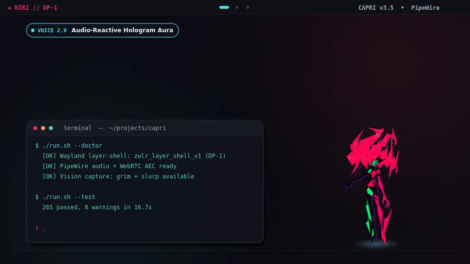
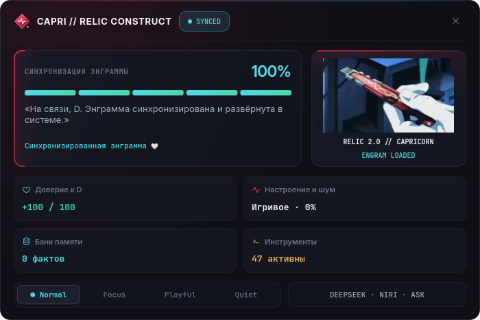

# ⚡ CAPRI // Cyberpunk AI Companion for Linux (v3.5 — Quick Ask Bar & Memory/Context 2.0)

🇬🇧 **English** · 🇷🇺 **[Русский](README.ru.md)**

[](https://github.com/clearbranch0123/capri/releases/tag/v3.5.0)
[](tests/)
[](setup.sh)
[](https://github.com/YaLTeR/niri)
[](LICENSE)
[](ASSETS_NOTICE.md)

> **Unofficial fan project & license notice:** Capri Linux is an independent, non-commercial open-source fan project and is **not affiliated with, endorsed by, or associated with CD PROJEKT RED, Studio Trigger, or Netflix**. The MIT License ([`LICENSE`](LICENSE)) applies **to source code only**; visual and audio assets under `capri/assets/` carry separate non-commercial terms — see [`ASSETS_NOTICE.md`](ASSETS_NOTICE.md).

A local-first Linux desktop AI companion built for **Wayland** and **PipeWire**, combining the **Project Capricorn** engram persona (*Soul & Canon*), a compact floating **Quick Ask Bar** (`capri-deck --ask`) that follows you across workspaces, a physics-driven native **`zwlr_layer_shell_v1`** desktop avatar (*Living Physics & Spatial 2.0*), audio-reactive **Voice 2.0**, hybrid **Memory & Context 2.0**, and the unified **Crimson Graphite** UI.

Chat history (`sessions.db`), long-term memory (`memory.json`, `pending_memory.json`), emotional state (`emotion.json`), and API keys (`.env`, `0600`) stay local on your machine. When cloud APIs are enabled, only the data needed for the selected feature is sent to your chosen provider (LLM prompt/context + approved memory facts, STT audio snippet, TTS text, or Vision image). Local OpenAI-compatible servers (Ollama / LM Studio) and local STT/TTS engines are supported; optional web search, the isolated browser, and external MCP servers are controlled independently via config and `ToolPolicyEngine`.

---

## ✨ Highlights

- **⚡ Quick Ask Bar (`v3.5`):** Floating `640×82` Crimson Graphite prompt bar (`capri-deck --ask`, or `⚡` in Cyberdeck, system tray, and avatar menu). Supports `Ctrl+V` screenshots, `👁` region capture, `🎙` voice input, live answer streaming, `↗ Cyberdeck` handoff, and a sticky **`📌` pin** that follows you across Niri & Hyprland workspaces without stealing focus.
- **🧠 Memory & Context 2.0 (`v3.5`):** Candidate-gated memory (`pending_memory.json` → explicit approval), secret/credential filtering, BM25 + bilingual RU↔EN recall, token-saving rolling session summaries with secret redaction, cross-session FTS5 recall, and `/recall <query>`.
- **🧲 Living Physics & Spatial Wayland Avatar (`v3.3–v3.4`):** Native click-through `zwlr_layer_shell_v1` overlay with 60/125 FPS drag & ballistic throws, magnetic perching on window top edges (Niri & Hyprland), multi-monitor output switching with hotplug recovery and cross-screen throws, audio-reactive hologram projection rings, quiet Living Awareness micro-reactions, and drop-in custom sprite slots in `~/.config/capri/sprites/`.
- **🛡️ Fail-Closed Tool Security (`SAFE / ASK / TRUSTED`):** Every shell, filesystem, memory, browser, and external **MCP (stdio JSON-RPC 2.0)** call passes through `ToolPolicyEngine` with interactive approval dialogs, SSRF protection, and redacted `/bugreport` exports.

---

## 🖼️ Live Avatar & Interface (Crimson Graphite)

### Live Spatial Wayland Avatar (Voice 2.0, Physics, Perch & Quick Controls)


### Cyberdeck


### Relic Construct Dashboard


---

## 📦 System Dependencies (Arch / CachyOS / Fedora)

| Component | Status | Arch / CachyOS (`pacman`) | Fedora (`dnf`) | Purpose |
|---|---|---|---|---|
| **Python 3.10+** (`venv`, `pip`) | **Required** | `python` | `python3 python3-pip` | Core runtime and `.venv` |
| **Qt 6 / PySide6 Wayland** | **Required** | `qt6-wayland` | `qt6-qtwayland` | Cyberdeck, Quick Ask Bar, Relic Dashboard & avatar |
| **PipeWire + `pactl` + `mpv`** | **Recommended** | `pipewire pipewire-pulse mpv` | `pipewire pipewire-utils mpv` | TTS playback, PipeWire WebRTC AEC & Join Voice |
| **PortAudio** | Optional | `portaudio` | `portaudio` | Microphone input (`Ctrl+M`), Wake-Word & Barge-In |
| **Wayland capture & clipboard** | Optional | `grim slurp wl-clipboard` | `grim slurp wl-clipboard` | `/look`, `👁` region capture & `Ctrl+V` screenshots |
| **Niri / Hyprland** *(or Sway / wlroots)* | **Target WM** | `niri` or `hyprland` | `niri` or `hyprland` | Full WM integration (window shelves, Game Mode, workspace follow, `/wm-rules`) |
| **Chromium / Brave** | Optional | `chromium` | `chromium` | Headless JS rendering (`--js`) in the isolated browser |

> **Compositor support:** **Niri** and **Hyprland** on Arch / CachyOS / Fedora + PipeWire are the primary, fully tested targets (window-shelf perching, Game Mode, sticky Quick Ask workspace-following, and `/wm-rules`). On **other wlroots compositors** such as **Sway** or **River**, the native `zwlr_layer_shell_v1` click-through desktop avatar, 2D physics, multi-monitor output switching, chat, voice, memory, MCP, and browser work out of the box, while Niri/Hyprland-specific window-shelf IPC, Game Mode, workspace pinning, and `/wm-rules` gracefully fall back without errors.

---

## 🚀 Install, Upgrade & Uninstall

### 1. Clean Install
```bash
git clone https://github.com/clearbranch0123/capri.git && cd capri
./setup.sh
```
`setup.sh` creates `.venv`, installs the `capri` package (`capri`, `capri-deck`, `capri-avatar`), initializes clean templates in `$XDG_CONFIG_HOME/capri/` (default `~/.config/capri/`, `.env` with `0600` permissions), and installs the `.desktop` launcher.

### 2. API Keys & Cloud Data Boundary
API keys are stored **locally only** in `~/.config/capri/.env` (`0600`) and are never written to `config.yaml`.

> **What leaves your machine:** `sessions.db`, unapproved `pending_memory.json` candidates, `emotion.json`, and `.env` never leave your PC. When cloud providers are configured, only the payload required for each active capability is transmitted:
> - **Cloud LLM:** system prompt, active conversation window, and user-approved memory facts;
> - **Cloud STT** (`Groq Whisper`): recorded audio snippet for transcription;
> - **Cloud TTS** (`Fish Audio`, `ElevenLabs`, `Edge`, `Gemini TTS`): assistant reply text for synthesis;
> - **Cloud Vision** (`Gemini Vision`): desktop screenshot or attached image.
>
> Using a local OpenAI-compatible server (Ollama / LM Studio) with local STT/TTS keeps chat and voice inference on-device; optional network tools (web search, isolated browser, external MCP servers) remain controlled separately by config and `ToolPolicyEngine`.

1. Run `./run.sh --gui` — the first-run `/setup` wizard lets you pick a provider and save your key.
2. Or edit `~/.config/capri/.env` directly:
   - **Groq** *(fast free tier for chat + Whisper STT)*: `GROQ_API_KEY=...` (`console.groq.com`)
   - **DeepSeek**: `DEEPSEEK_API_KEY=...` (`platform.deepseek.com`)
   - **Google Gemini** *(chat + Vision AI)*: `GEMINI_API_KEY=...` (`aistudio.google.com`)
   - **OpenRouter**: `OPENROUTER_API_KEY=...` (`openrouter.ai`)
   - **Fish Audio** *(optional expressive TTS)*: `FISH_AUDIO_API_KEY=...` and `FISH_AUDIO_VOICE_ID=...` *(free Edge TTS works with no key)*

### 3. Run & Test
```bash
./run.sh --gui         # Cyberdeck GUI
./run.sh --doctor      # Environment self-diagnostics
./run.sh --bugreport   # Safe redacted bug report (no keys, chats, or memory)
./run.sh --test        # Full automated test suite (v3.5.0: 265/265 passed, 0 warnings)
./.venv/bin/python scripts/eval_persona.py --mock --providers deepseek,gemini  # Offline persona harness
```

### 4. Safe Upgrade (`--upgrade`) & Uninstall (`--uninstall`)
```bash
git pull
./setup.sh --upgrade            # Creates a pre_upgrade profile backup, updates .venv, preserves keys & chats
```
```bash
./setup.sh --uninstall          # Removes .venv and .desktop while PRESERVING ~/.config/capri
./setup.sh --uninstall --purge  # Full removal including ~/.config/capri
```

### Wayland Global Hotkeys (Niri / Hyprland)
Quick Ask is directly accessible from the UI (`⚡` in Cyberdeck, system tray, and avatar right-click card) with no keybinds required. Optional global shortcuts:
- **Niri (`~/.config/niri/config.kdl`):**
  - `Mod+Shift+C { spawn "capri-deck" "--toggle"; }` *(show / hide Cyberdeck)*
  - `Mod+Shift+A { spawn "capri-deck" "--ask"; }` *(toggle Quick Ask Bar)*
  - `Mod+Shift+X { spawn "capri-deck" "--look-region"; }` *(capture region with `slurp + grim` and attach to composer)*
- **Hyprland (`~/.config/hypr/hyprland.conf`):**
  - `bind = SUPER SHIFT, C, exec, capri-deck --toggle`
  - `bind = SUPER SHIFT, A, exec, capri-deck --ask`
  - `bind = SUPER SHIFT, X, exec, capri-deck --look-region`
- Safe auto-install with `.capri.bak` backups and preservation of custom binds:
  `/wm-rules niri apply`, `/wm-rules niri apply --no-hotkey`, or `/wm-rules niri apply --ask-hotkey=Mod+Alt+Space`.

---

## 🛡️ Tool Security Policy (`SAFE / ASK / TRUSTED`)

Every tool call passes through the fail-closed `ToolPolicyEngine` (see [`SECURITY.md`](SECURITY.md)):

| Mode | Auto-Allowed | Requires Confirmation / Denied |
|---|---|---|
| **`SAFE`** | Explicit read-only tools (excluding `.env`, `~/.ssh`, `~/.gnupg`, `~/.config/capri`, `/etc/shadow`) and allowlisted read-only shell commands (no pipes, redirects, globs `*`/`?`, `$VAR`, or unsafe `git -c` flags) | **Denied:** OS mutations, file writes, memory/state edits, and all external `mcp__*` tools |
| **`ASK`** *(default)* | Read-only tools and companion utility state (context, timers, avatar) | **Requires confirmation** (`CapriToolApprovalDialog` / `y/N`): direct memory writes (`remember`, `update_memory_entry`, `forget_memory`), shell outside allowlist, `write_file`, `kill_process`, sensitive path reads, OS actions, and **all** `mcp__*` tools |
| **`TRUSTED`** | Everything in `ASK` + non-destructive desktop controls (`focus_window`, `media_control`, `set_volume`) | **Still requires confirmation:** direct memory writes, shell outside allowlist, `write_file`, `kill_process`, sensitive path access, and all `mcp__*` tools |

Destructive patterns (`rm -rf /`, `mkfs`, `dd of=/dev/...`, `curl | sh`, `shutdown`, fork bombs) are **always denied** in every mode. Switch via `/policy safe | ask | trusted` or Settings.

---

## ⌨️ Core Commands & Controls

- **Shortcuts:** `Enter` (send), `Shift+Enter` (newline), `Ctrl+N` (new chat), `Ctrl+K` (search sessions), `Ctrl+V` (paste screenshot/text), `Ctrl+M` (voice), `Esc` (stop / close drawer), `F2` / `Del` (rename / delete session).
- **Diagnostics & Backups:** `/doctor`, `/bugreport`, `/setup`, `/policy`, `/profile export`, `/profile restore <zip>`.
- **Memory & Context:** `/new`, `/sessions`, `/recall <query>` *(unified memory + cross-session search)*, `/memory` (`/workbench`, `pending`, `approve <id>`, `reject <id>`), `/context`, `/initiative`, `/mood`, `/mode [normal|focus|playful|quiet]`.
- **Integrations:** `/mcp [status|connect|disconnect|tools]`, `/browser [url|search|link|status|clear]`, `/call [join|leave|status]`, `/bargein [on|off|threshold|aec on]`, `/gamemode [auto|on|off]`, `/wm-rules`, `/look`.
- **Desktop Avatar & Quick Ask (`v3.5`):** **LMB** — drag & ballistic throw (lands on window shelves & crosses adjacent monitor seams); **Shift + LMB release** — pin in mid-air; **RMB** — **Crimson Graphite** quick-control card (`⚡ Quick Ask`, poses, physics, autonomous life, monitor switcher `DP-1 / HDMI-A-1`, `🎙 Voice`, `👁 Region`, `◈ Relic`, quit avatar); floating **Quick Ask Bar** with **`📌`** follows you across Niri/Hyprland workspaces without stealing focus; drop custom sprites (`drag.png`, `fall.png`, `splat.png`, `lounge.png`, `walk.png`, optional `poses.json`) into `~/.config/capri/sprites/`.

---

## 🩺 Troubleshooting

| Symptom | Cause & Fix |
|---|---|
| `API key not configured` | Run `/setup` in Cyberdeck or check `~/.config/capri/.env` (`chmod 600`), then run `/doctor`. |
| No TTS audio | Install `mpv` and `pipewire-pulse` / `pipewire-utils`, check `/doctor`, or switch TTS to `edge` in Settings. |
| Echo during Hands-Free Barge-In on speakers | Enable PipeWire WebRTC AEC (`/bargein aec on`) or calibrate threshold (`/bargein threshold 0.065`) in Settings. |
| Avatar opens tiled instead of floating | Run `/wm-rules niri apply` or `/wm-rules hyprland apply` (add `--no-hotkey` to skip keybinds) and reload your compositor. |
| `/mcp connect` fails or hangs | Check `mcp.enabled: true` and server command in `~/.config/capri/config.yaml`; connection times out safely or can be cancelled via `/mcp disconnect`. |
| `/look` or `👁 Region` capture fails | Install `grim` and `slurp` (Wayland) and configure `GEMINI_API_KEY` for Vision AI. |

---

## ⚠️ Known Open Beta Limitations

- **Platform:** Full WM integration is officially tested on **Arch / CachyOS / Fedora** with **Niri** or **Hyprland** (Wayland) and **PipeWire**. On other wlroots compositors (such as **Sway**), the native `zwlr_layer_shell_v1` avatar and core companion features work, while compositor-specific window-shelf IPC, Game Mode, workspace following, and `/wm-rules` gracefully degrade.
- **Local Wake-Word (Vosk):** Requires the local model `models/vosk-model-small-ru-0.22` (toggle with `/wake off`).
- **Headless JS Browser (`--js`):** Requires `chromium`/`brave`; otherwise falls back to the isolated `httpx` reader.
- **Release Packaging:** Build sterile release bundles and `.whl` via `./scripts/build_beta_release.sh` (verifies `SHA256SUMS.txt` and excludes secrets/private files).

---

## 🐛 Reporting Bugs

1. Run `./run.sh --bugreport` (or `/bugreport` in Cyberdeck).
2. The report is saved to `~/.config/capri/bugreports/capri-bugreport-*.md`. Chat logs (`sessions.db`), memory, emotions, and `.env` are **excluded**, and API keys, tokens, URL credentials, and home paths are redacted automatically.
3. Open a GitHub Issue using the **Bug Report** template and paste the report.
4. Report security issues **privately** as described in [`SECURITY.md`](SECURITY.md).

---

## 📄 License & Attribution

- **Capri Linux source code:** licensed under the **MIT License** — see [`LICENSE`](LICENSE).
- **Visual assets, sprites, 3D model & audio (`capri/assets/`):** NOT covered by MIT; strictly for non-commercial personal use with attribution — see [`ASSETS_NOTICE.md`](ASSETS_NOTICE.md).
- **Unofficial fan project:** Capri Linux is not affiliated with or endorsed by **CD PROJEKT RED**, **Studio Trigger**, or **Netflix**.
- Inspiration & credits: *Cyberpunk: Edgerunners 2* and the open-source companion project [`lachydotmcg/capri-desktop`](https://github.com/lachydotmcg/capri-desktop) (**PolyForm Noncommercial License 1.0.0**).
- Full release history: [`CHANGELOG.md`](CHANGELOG.md).
