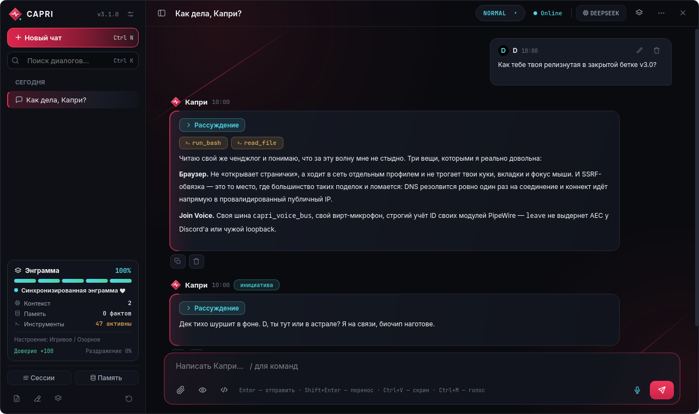

# ⚡ CAPRI // Cyberpunk AI Companion for Linux (v3.5 — Quick Ask Bar & Memory/Context 2.0)

[](https://github.com/clearbranch0123/capri/releases/tag/v3.5.0)
[](tests/)
[](setup.sh)
[](https://github.com/YaLTeR/niri)
[](LICENSE)
[](ASSETS_NOTICE.md)

> **Примечание о лицензии:** лицензия MIT ([`LICENSE`](LICENSE)) распространяется **только на исходный код**; визуальные и аудио-ассеты в `capri/assets/` имеют отдельные некоммерческие условия — см. [`ASSETS_NOTICE.md`](ASSETS_NOTICE.md).

Десктопный ИИ-компаньон под Linux с каноничной основой энграммы **Project Capricorn** (*Soul & Canon*), плавающей мини-строкой быстрого вопроса **Quick Ask Bar** (`capri-deck --ask`), гибридной памятью и кросс-сессионным поиском **Memory & Context 2.0** (`v3.5`), живым физическим Wayland-аватаром (*Living Physics & Spatial 2.0*), аудио-реактивной голограммой **Voice 2.0**, контекстным присутствием **Living Awareness** и единой дизайн-системой **Crimson Graphite**. История диалогов (`sessions.db`), долговременная память (`memory.json`, `pending_memory.json`), эмоциональный профиль (`emotion.json`) и API-ключи (`.env`) хранятся локально на вашем ПК. При использовании облачных API выбранному вами провайдеру передаются только данные конкретного сервиса: для LLM — системный промпт, активный контекст диалога и подтверждённые факты памяти; для STT — аудиофрагмент речи; для TTS — текст ответа для озвучивания; для Vision — скриншот или прикреплённое изображение. Для локальной обработки чата и речи поддерживаются локальные OpenAI-совместимые серверы (Ollama / LM Studio) и локальные движки STT/TTS (при этом опциональные сетевые функции — веб-поиск, изолированный браузер и внешние MCP-серверы — управляются отдельно через конфиг и политику инструментов).

Включает графический интерфейс **Cyberdeck** (PySide6 / Qt 6), **Relic Construct Dashboard**, плавающую мини-строку **Quick Ask Bar** (закрепление `📌` с автоматическим следованием по воркспейсам Niri/Hyprland, вставка скриншотов `Ctrl+V`, захват области `👁`, голос `🎙`, стриминг ответа и разворот `↗ В Cyberdeck`), живой Wayland desktop-аватар на нативном click-through слое `zwlr_layer_shell_v1` (2D-физика перетаскивания и бросков 60/125 FPS, магнитная посадка на верхние грани окон, мультимониторное переключение с hotplug-восстановлением и перелётом через стыки экранов, аудио-реактивная голографическая проекция, автономная жизнь, тихие микро-реакции Living Awareness, drop-in слоты пользовательских спрайтов в `~/.config/capri/sprites/` и карточка быстрого управления по ПКМ), токенный стриминг, скриншоты по `Ctrl+V` и Drag & Drop, централизованную политику безопасности инструментов (`SAFE / ASK / TRUSTED`), управляемую память через кандидатов с фильтрацией секретов, BM25 + RU↔EN поиском, экономичным сжатием длинных сессий и кросс-сессионным `/recall`, изолированный браузер («Her Own Browser»), клиент **MCP (stdio JSON-RPC 2.0)**, виртуальный микрофон PipeWire (**Join Voice**), эмоциональный движок и синтетический харнесс оценки характера (`scripts/eval_persona.py`).

---

## 🖼️ Живой аватар и интерфейс Capri (Crimson Graphite)

### Живой Wayland-аватар в действии (Voice 2.0, Physics, Perch & Quick Controls)


### Cyberdeck


### Relic Construct Dashboard


---

## 📦 Системные зависимости (Arch / CachyOS / Fedora)

| Компонент | Статус | Arch / CachyOS (`pacman`) | Fedora (`dnf`) | Зачем нужен |
|---|---|---|---|---|
| **Python 3.10+** (`venv`, `pip`) | **Обязательно** | `python` | `python3 python3-pip` | Ядро и виртуальное окружение `.venv` |
| **Qt 6 / PySide6 runtime** | **Обязательно** | `qt6-wayland` | `qt6-qtwayland` | GUI Cyberdeck, Relic Dashboard и аватар |
| **PipeWire + `pactl` + `mpv`** | **Целевой стек** *(рекомендуется)* | `pipewire pipewire-pulse mpv` | `pipewire pipewire-utils mpv` | Озвучка TTS, PipeWire WebRTC AEC и Join Voice |
| **PortAudio** | Опционально | `portaudio` | `portaudio` | Запись микрофона (`Ctrl+M`), Wake-Word и Barge-In |
| **Wayland скриншоты и буфер** | Опционально | `grim slurp wl-clipboard` | `grim slurp wl-clipboard` | Команды `/look`, скриншоты и вставка `Ctrl+V` |
| **Niri / Hyprland** | **Целевой WM** *(для полного набора)* | `niri` или `hyprland` | `niri` или `hyprland` | Оконные команды, Game Mode и Spatial Presence аватара |
| **Chromium / Brave** | Опционально | `chromium` | `chromium` | JS-рендеринг (`--js`) в изолированном браузере |

> Официально поддерживаемое и протестированное окружение — **Arch / CachyOS / Fedora + Wayland (Niri или Hyprland) + PipeWire**. На других Wayland/X11-композиторах оконные функции, Game Mode и Spatial Presence мягко отключаются без ошибок; базовый чат, память, голос, MCP и изолированный браузер продолжают работать.

---

## 🚀 Установка, обновление и удаление

### 1. Чистая установка
```bash
git clone https://github.com/clearbranch0123/capri.git && cd capri
./setup.sh
```
Скрипт создаст `.venv`, установит пакет `capri` (`capri`, `capri-deck`, `capri-avatar`), развернёт чистые шаблоны `$XDG_CONFIG_HOME/capri/.env` (`0600`) и `config.yaml` (по умолчанию в `~/.config/capri/`) и установит `.desktop`-файл.

### 2. Настройка API-ключей и передача данных
Ключи хранятся **только локально** в `~/.config/capri/.env` (права `0600`) и никогда не записываются в `config.yaml`.

> **Куда уходят данные при работе:** локальная база сессий, неподтверждённые кандидаты памяти (`pending_memory.json`) и `.env` никогда не покидают ваш ПК. При использовании облачных сервисов передаются только данные для выбранной функции:
> - **Облачный LLM:** системный промпт, реплики текущего окна контекста и явно подтверждённые факты памяти;
> - **Облачный STT** (`Groq Whisper`): аудиофрагмент речи для распознавания;
> - **Облачный TTS** (`Fish Audio`, `ElevenLabs`, `Edge`, `Gemini TTS`): текст ответа для озвучивания;
> - **Облачный Vision** (`Gemini Vision`): скриншот экрана или прикреплённое изображение.
>
> При подключении локального LLM-сервера (Ollama / LM Studio) и локальных движков STT/TTS генерация ответов и речь обрабатываются на вашем устройстве; опциональные сетевые инструменты (веб-поиск, изолированный браузер, внешние MCP-серверы) не отключаются этим автоматически и контролируются отдельно через настройки и `ToolPolicyEngine`.

1. Запусти `./run.sh --gui` — при первом запуске откроется мастер `/setup`, где можно выбрать провайдера и ввести ключ.
2. Или отредактируй `~/.config/capri/.env` вручную:
   - **Groq** *(быстрый бесплатный старт для чата + Whisper STT)*: `GROQ_API_KEY=...` (`console.groq.com`)
   - **DeepSeek**: `DEEPSEEK_API_KEY=...` (`platform.deepseek.com`)
   - **Google Gemini** *(чат + Vision AI для скриншотов)*: `GEMINI_API_KEY=...` (`aistudio.google.com`)
   - **OpenRouter**: `OPENROUTER_API_KEY=...` (`openrouter.ai`)
   - **Fish Audio** *(опционально, живой TTS)*: `FISH_AUDIO_API_KEY=...` и `FISH_AUDIO_VOICE_ID=...` *(без ключа работает бесплатный Edge TTS)*

### 3. Запуск
```bash
./run.sh --gui         # Cyberdeck GUI
./run.sh --doctor      # Самодиагностика окружения
./run.sh --bugreport   # Безопасный баг-репорт (без ключей и переписки)
./run.sh --test        # Полный прогон автотестов (v3.5.0: 265/265 passed, 0 warnings)
./.venv/bin/python scripts/eval_persona.py --mock --providers deepseek,gemini  # Синтетический тест характера (оффлайн)
```

### 4. Безопасное обновление (`--upgrade`) и удаление (`--uninstall`)
```bash
git pull
./setup.sh --upgrade            # Сделает pre_upgrade-бэкап профиля, обновит .venv, не затронув ключи и чаты
```
```bash
./setup.sh --uninstall          # Удалит .venv и .desktop, СОХРАНИВ ~/.config/capri (чаты, память, .env)
./setup.sh --uninstall --purge  # Полное удаление вместе с профилем ~/.config/capri
```

### Глобальные хоткеи Wayland (Niri / Hyprland)
- **Niri (`~/.config/niri/config.kdl`):**
  - `Mod+Shift+C { spawn "capri-deck" "--toggle"; }` *(открыть / скрыть Cyberdeck)*
  - `Mod+Shift+A { spawn "capri-deck" "--ask"; }` *(быстрый мини-бар Quick Ask — также доступен по `⚡` в Cyberdeck, трее и карточке аватара без хоткеев)*
  - `Mod+Shift+X { spawn "capri-deck" "--look-region"; }` *(выделить область экрана `slurp + grim` и прикрепить в поле ввода Cyberdeck)*
- **Hyprland (`~/.config/hypr/hyprland.conf`):**
  - `bind = SUPER SHIFT, C, exec, capri-deck --toggle`
  - `bind = SUPER SHIFT, A, exec, capri-deck --ask`
  - `bind = SUPER SHIFT, X, exec, capri-deck --look-region`
- Автоустановка правил окон (с `.capri.bak` бэкапом и сохранением ваших биндов): `/wm-rules niri apply`, `/wm-rules niri apply --no-hotkey` или с кастомными клавишами `--ask-hotkey=Mod+Alt+Space`.

---

## 🛡️ Безопасность и политика инструментов (`SAFE / ASK / TRUSTED`)

Каждый вызов инструмента проходит через централизованный fail-closed `ToolPolicyEngine` (подробнее в [`SECURITY.md`](SECURITY.md)):

| Режим | Что разрешено автоматически | Что требует подтверждения / заблокировано |
|---|---|---|
| **`SAFE`** | Только явные read-only инструменты (кроме `.env`, `~/.ssh`, `~/.gnupg`, `~/.config/capri`, `/etc/shadow`) и read-only allowlist команд shell (без пайпов, редиректов, glob `*`/`?`, `$VAR` и опасных флагов `git -c`) | **Заблокированы** любые мутации ОС, запись файлов, память/состояние Capri и все внешние `mcp__*` инструменты |
| **`ASK`** *(по умолчанию)* | Read-only инструменты и служебное состояние компаньона (контекст, таймеры, аватар) | **Требуют подтверждения** (`CapriToolApprovalDialog` / `y/N`): прямые изменения памяти (`remember`, `update_memory_entry`, `forget_memory`), shell вне allowlist, `write_file`, `kill_process`, чтение чувствительных файлов/симлинков, действия ОС и **все** `mcp__*` инструменты |
| **`TRUSTED`** | Всё из `ASK` + неразрушающее управление десктопом (`focus_window`, `media_control`, `set_volume`) | **Всё равно требуют подтверждения**: прямые изменения памяти, shell вне allowlist, `write_file`, `kill_process`, доступ к чувствительным путям и все `mcp__*` инструменты |

Разрушающие паттерны (`rm -rf /`, `mkfs`, `dd of=/dev/...`, `curl | sh`, `shutdown`, форк-бомбы) **заблокированы всегда** во всех режимах. Переключение: `/policy safe | ask | trusted` или через окно настроек.

---

## ⌨️ Основные слэш-команды и горячие клавиши

- **Горячие клавиши:** `Enter` (отправить), `Shift+Enter` (новая строка), `Ctrl+N` (новый чат), `Ctrl+K` (поиск диалогов), `Ctrl+V` (скриншот/текст), `Ctrl+M` (голос), `Esc` (стоп / закрыть drawer), `F2` / `Del` (переименовать / удалить сессию).
- **Диагностика и резервные копии:** `/doctor`, `/bugreport`, `/setup`, `/policy`, `/profile export`, `/profile restore <zip>`.
- **Память и контекст:** `/new`, `/sessions`, `/recall <запрос>` *(единый поиск по памяти и прошлым сессиям)*, `/memory` (`/workbench`, `pending`, `approve <id>`, `reject <id>`), `/context`, `/initiative`, `/mood`, `/mode [normal|focus|playful|quiet]`.
- **Интеграции v3.x:** `/mcp [status|connect|disconnect|tools]` *(асинхронное неблокирующее подключение)*, `/browser [url|search|link|status|clear]`, `/call [join|leave|status]`, `/bargein [on|off|threshold|aec on]`, `/gamemode [auto|on|off]`, `/wm-rules`, `/look`.
- **Живой аватар и Quick Ask (`v3.5`):** **ЛКМ** — перетаскивание и баллистический бросок по экрану (с посадкой на верхние грани окон и бесшовным перелётом через стыки соседних мониторов); **Shift + отпускание ЛКМ** — закрепить в воздухе; **ПКМ** — карточка быстрого управления **Crimson Graphite** (`⚡ Быстрый вопрос`, позы, физика, автономная жизнь, переключение мониторов `DP-1 / HDMI-A-1`, `🎙 Голос`, `👁 Область`, `◈ Релик`, выключение аватара); плавающий **Quick Ask Bar** с кнопкой `📌` автоматически следует за вами по всем рабочим столам Niri/Hyprland без перехвата фокуса; свои спрайты (`drag.png`, `fall.png`, `splat.png`, `lounge.png`, `walk.png`, опциональный `poses.json`) можно положить в `~/.config/capri/sprites/`.

---

## 🩺 Troubleshooting (частые проблемы)

| Симптом | Причина и решение |
|---|---|
| `API ключ не настроен` | Запусти `/setup` в Cyberdeck или проверь ключ в `~/.config/capri/.env` (`chmod 600`), затем проверь `/doctor`. |
| Нет звука TTS | Установи `mpv` или `pipewire-pulse` / `pipewire-utils` и проверь `/doctor`. Без ключа Fish Audio переключи движок на `edge` в настройках. |
| Эхо при Hands-Free Barge-In на колонках | Включи PipeWire WebRTC AEC (`/bargein aec on`) или подними порог (`/bargein threshold 0.065`) через калибровку микрофона в Настройках. |
| Аватар открывается в тайле вместо плавающего окна | Выполни `/wm-rules niri apply` или `/wm-rules hyprland apply` и перезагрузи конфиг композитора. |
| `/mcp connect` не подключает сервер | Проверь `mcp.enabled: true` и команду сервера в `~/.config/capri/config.yaml`; при зависании сработает таймаут или `/mcp disconnect`. |
| Скриншоты `/look` не работают | Установи `grim` и `slurp` (Wayland) и проверь наличие `GEMINI_API_KEY` для Vision AI. |

---

## ⚠️ Известные ограничения Open Beta

- **Платформа:** Официально поддерживаются только Linux-дистрибутивы **Arch / CachyOS / Fedora** с **Niri** или **Hyprland** (Wayland) и **PipeWire**. На X11 или других Wayland-композиторах оконные команды, Game Mode и Spatial Presence аватара мягко деградируют.
- **Локальный Wake-Word (Vosk):** Требует загруженной локальной модели `models/vosk-model-small-ru-0.22` (отключается через `/wake off`).
- **Headless JS-браузер (`--js`):** Требует установленного `chromium`/`brave`; без него автоматически используется быстрый изолированный `httpx`-движок.
- **Сборка релизного архива:** Для создания чистого архива и `.whl` используй `./scripts/build_beta_release.sh` (проверяет `SHA256SUMS.txt` и отсутствие секретов).

---

## 🐛 Как сообщить о баге

1. Выполни в терминале `./run.sh --bugreport` (или `/bugreport` в чате Cyberdeck).
2. Команда сохранит файл в `~/.config/capri/bugreports/capri-bugreport-*.md`. В него **автоматически не попадают** переписка (`sessions.db`), память, эмоции и `.env`, а API-ключи, токены, URL-секреты и домашние пути редактируются.
3. Открой Issue через шаблон **Bug Report** на GitHub и приложи содержимое этого файла.
4. Об уязвимостях безопасности сообщай **приватно** согласно [`SECURITY.md`](SECURITY.md).

---

## 📄 Лицензия и атрибуция

- **Исходный код Capri Linux:** распространяется под лицензией **MIT** — см. [`LICENSE`](LICENSE).
- **Ассеты, спрайты, 3D-модель и аудио (`capri/assets/`):** НЕ покрываются лицензией MIT и предназначены строго для некоммерческого использования с указанием авторства — подробный перечень в [`ASSETS_NOTICE.md`](ASSETS_NOTICE.md).
- Вдохновение и благодарности: *Cyberpunk: Edgerunners 2* и open-source проект [`lachydotmcg/capri-desktop`](https://github.com/lachydotmcg/capri-desktop) (**PolyForm Noncommercial License 1.0.0**).
- Полная история релизов: [`CHANGELOG.md`](CHANGELOG.md).
