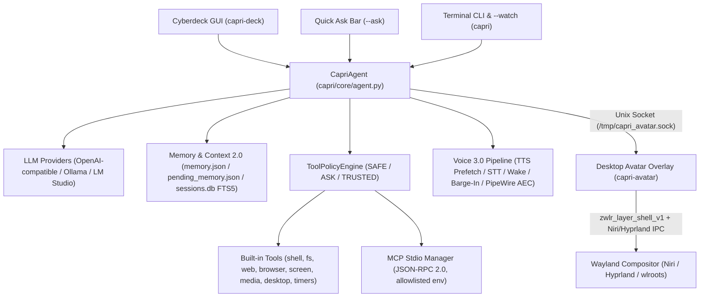

# Capri Architecture Overview

Capri is a local-first Linux desktop AI companion built around **Wayland (`zwlr_layer_shell_v1`)**, **PipeWire**, and **Qt 6 / PySide6**. This document maps the core subsystems, IPC boundaries, security controls, and packaging layout.

---

## 1. High-Level Topology

---

## 2. Package Layout

| Module | Responsibility |
|---|---|
| `capri/core/agent.py` | Main orchestration loop: prompt assembly, streaming LLM responses, tool-call dispatch, memory recall, rolling session summaries, and voice/avatar hooks. |
| `capri/core/config.py` | Pydantic configuration (`AppConfig`), XDG profile paths (`$XDG_CONFIG_HOME/capri`), and local `.env` (`0600`) secret loading. |
| `capri/core/policy.py` | Fail-closed `ToolPolicyEngine` (`safe` / `ask` / `trusted`), symlink/path canonicalization, sensitive file guards, and read-only shell allowlisting. |
| `capri/core/mcp_client.py` | Event-loop-independent stdio JSON-RPC 2.0 MCP client with strict allowlisted environment isolation, 1 MiB frame limits, tag-breakout escaping, and secret redaction. |
| `capri/core/sessions.py` | Local SQLite conversation store (`sessions.db`) with FTS5 full-text search, cross-session recall, and session export/backup hooks. |
| `capri/core/persona.py` & `capri/core/emotions.py` | Persona prompt construction, emotional state persistence (`emotion.json`), and relationship/mood modulation. |
| `capri/core/focus_timer.py` | Pomodoro / Focus Timer controller (`OFF -> 25m -> 50m -> 15m`) coordinating avatar aura progress and silence gating. |
| `capri/core/watch_runner.py` | Native TTY command wrapper (`capri --watch "<cmd>"`) propagating exit codes and signaling avatar/desktop/TTS alerts on completion. |
| `capri/core/systemd_service.py` | Optional `systemd --user` unit generator/status/installer for `capri-avatar.service` (supports both user overrides and `/usr/lib/systemd/user` packaged units). |
| `capri/core/doctor.py` | Non-mutating self-diagnostics (`/doctor`) and secret-redacted `/bugreport` generation. |
| `capri/core/compositor.py` & `capri/core/wm_rules.py` | Wayland compositor detection (Niri, Hyprland, wlroots), window geometry/workspace IPC, and safe `.capri.bak` rule installation. |
| `capri/ui/cyberdeck.py` | Primary Qt 6 Cyberdeck window, session management, settings, slash commands, Memory Workbench, and async worker supervision. |
| `capri/ui/quick_ask.py` | Compact floating Quick Ask Bar (`capri-deck --ask`) with sticky workspace pinning, screenshot/voice capture, and Cyberdeck handoff. |
| `capri/ui/overlay.py` & `capri/ui/sprite_view.py` | Native `zwlr_layer_shell_v1` click-through desktop avatar, 2D physics/perching, multi-monitor hotplug handling, audio-reactive projection aura, and `--systemd` reconnect lifecycle. |
| `capri/ui/client.py` | Lightweight Unix-socket IPC client talking to `capri-avatar` (`/tmp/capri_avatar.sock`). |
| `capri/ui/i18n.py` | Bilingual `RU` / `EN` UI dictionary, pluralization, and live language propagation. |
| `capri/voice/tts.py` | Streaming TTS 3.0 (`SentenceStreamSplitter`, sliding prefetch window, WAV/PyAV/MP3 envelope extraction, 25 Hz audio-level dispatcher, Fish/Edge/ElevenLabs/Gemini/Silero/XTTS backends). |
| `capri/voice/stt.py`, `wake.py`, `ptt.py`, `barge_in.py`, `pipewire.py` | Speech recognition (Groq Whisper / local faster-whisper), optional Vosk wake-word, optional evdev Push-to-Talk, hands-free barge-in, and PipeWire WebRTC AEC / Join Voice routing. |
| `capri/tools/` | Registry and built-in tools (`shell.py`, `fs.py`, `web.py`, `browser.py`, `screen.py`, `media.py`, `desktop.py`, `memory.py`, `timers.py`). |
| `packaging/arch/PKGBUILD` | Arch / CachyOS package build installing wheel entrypoints, `.desktop` file, dual license notices, and `/usr/lib/systemd/user/capri-avatar.service`. |

---

## 3. Runtime Boundaries & Persistence

- **User profile (`$XDG_CONFIG_HOME/capri/`, default `~/.config/capri/`):**
  - `.env` (`0600`): API keys and secrets (never written to `config.yaml`, never exported in profile backups).
  - `config.yaml`: Non-secret application configuration.
  - `sessions.db`: Local SQLite chat history + FTS5 index.
  - `memory.json` / `pending_memory.json`: Confirmed long-term memory facts and unapproved candidate facts.
  - `emotion.json`, `context.json`, `initiative.json`: Companion state and awareness metadata.
  - `sprites/`: Optional drop-in custom sprite overrides.
- **Local IPC:**
  - `/tmp/capri_avatar.sock` & `/tmp/capri_avatar.pid`: JSON-lines IPC between Cyberdeck/CLI and the standalone `capri-avatar` process (avatar state, speech/mic audio levels, focus timer sync, config sync).
- **Optional `systemd --user` lifecycle:**
  - `capri-avatar --mode 2d --systemd` waits for a live Wayland Unix socket (`WAYLAND_DISPLAY` / `XDG_RUNTIME_DIR/wayland-*`) and exits with code `1` if the compositor closes the layer surface so `Restart=on-failure` cleanly reattaches after compositor restarts.

---

## 4. Security Model

1. **Fail-Closed Tool Execution (`ToolPolicyEngine`):**
   - `SAFE` blocks mutating/external tools; `ASK` prompts for explicit user approval; `TRUSTED` permits standard non-sensitive actions while still gating sensitive paths and external MCP tools.
   - All filesystem paths are canonicalized (`realpath`) to defeat symlink traversal to `.env`, `~/.ssh`, `~/.config/autostart`, `~/.config/systemd/user`, or `.git/hooks`.
   - Subprocess output in `run_bash` and `find_files` is strictly byte-bounded to prevent memory exhaustion.
2. **Isolated MCP Subprocess Environments:**
   - External MCP servers inherit only an explicit allowlist of non-secret runtime environment variables (`PATH`, `HOME`, `USER`, `LANG`, `LC_*`, `XDG_*`, display/proxy/cert vars, virtual env paths) plus variables explicitly declared in that server's `mcp.servers[*].env` block.
   - Capri's own `.env` keys (`GROQ_API_KEY`, `DEEPSEEK_API_KEY`, `GEMINI_API_KEY`, etc.) are never implicitly passed to MCP child processes.
   - MCP stdout frames are capped at 1 MiB, outputs are wrapped in `<mcp_tool_output untrusted="true">` with tag-breakout escaping, and secrets are scrubbed from stderr/RPC errors.
3. **SSRF & Prompt-Injection Hardening (`web.py`, `browser.py`):**
   - Only `http://` and `https://` URLs are allowed; loopback, RFC1918 private, link-local/metadata, CGNAT, and mapped internal IPv6 ranges are rejected via single-resolution IP pinning and an ephemeral local proxy for headless Chromium.
   - Web content is framed in `<web_page_content untrusted="true">` with closing-tag neutralization.
4. **Redacted Diagnostics (`/bugreport`):**
   - Strips API keys, bearer tokens, JWTs, URL credentials/query tokens, MCP env secrets, and ANSI/control sequences before writing Markdown reports.

---

## 5. Modular Dependencies & Packaging

- **Core (`pip install .`):** Lean desktop/CLI/GUI/LLM/MCP runtime (`PySide6`, `openai`, `httpx`, `aiohttp`, `pydantic`, `numpy`, `pillow`, `pyyaml`, `python-dotenv`, `rich`). Optional voice/STT/vision/web modules degrade gracefully when omitted.
- **Optional extras in `pyproject.toml`:**
  - `capri[voice]` — Edge TTS, Fish Audio, ElevenLabs, PortAudio (`sounddevice`), and global PTT (`evdev`).
  - `capri[local-stt]` — Offline `faster-whisper` and `vosk` wake-word engine.
  - `capri[vision]` — Google GenAI SDK (`google-genai`).
  - `capri[web]` — `duckduckgo-search` (falls back to Wikipedia API when omitted).
  - `capri[all]` — All optional extras combined (installed by default via `./setup.sh`; pass `./setup.sh --minimal` for core-only).
- **Arch / CachyOS (`packaging/arch/PKGBUILD`):** Installs the core wheel with official Arch repository dependencies only, plus desktop entry, dual license notices (`LICENSE` + `ASSETS_NOTICE.md`), and `/usr/lib/systemd/user/capri-avatar.service`.
